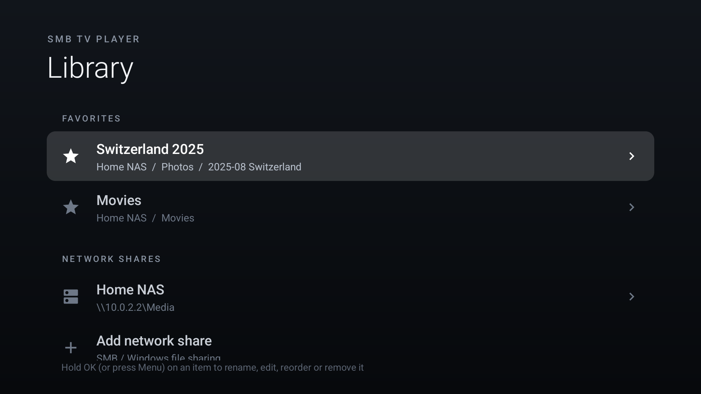
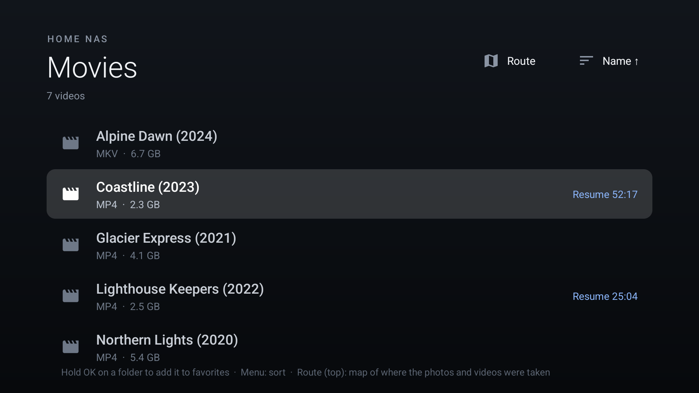
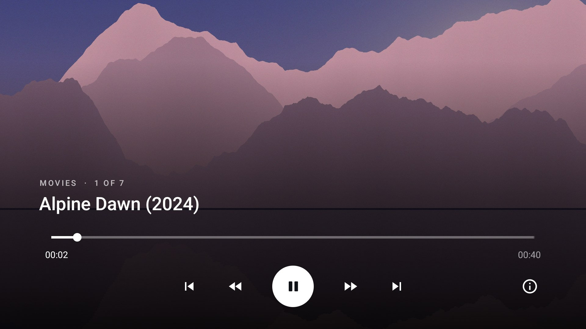
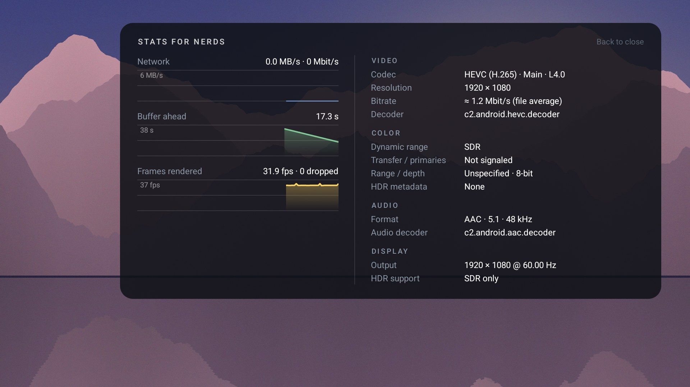
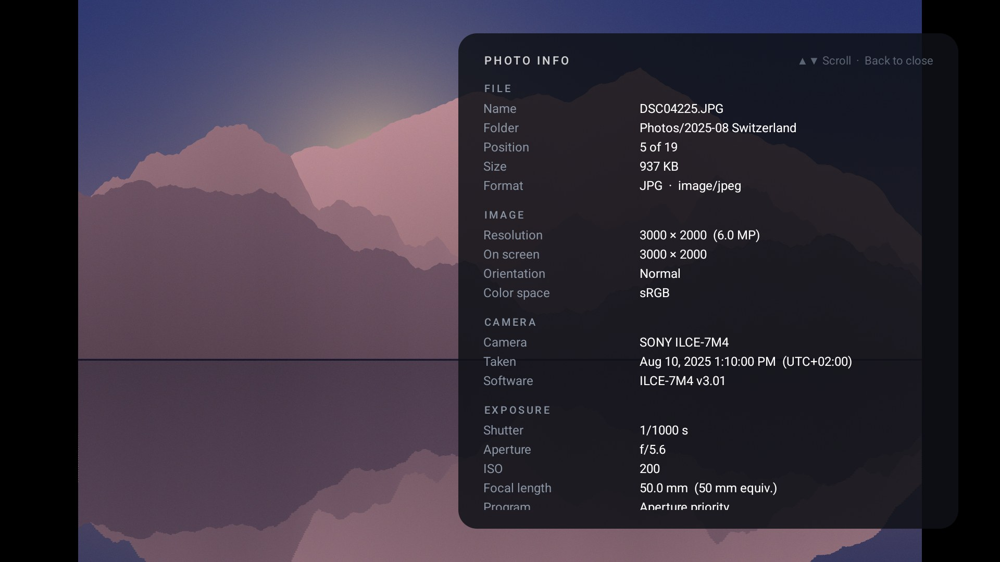
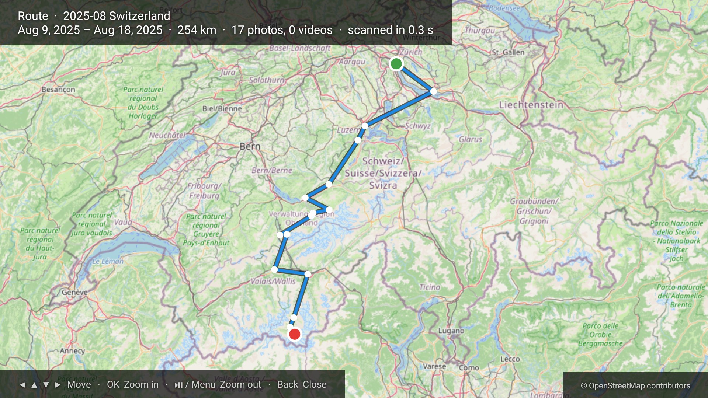

# SMB TV Player

A fast, minimal Android TV player for videos and photos on SMB/CIFS network shares (NAS, Windows shares, Samba).
Built for low-power TV boxes, e.g. Amlogic S905Y4 with 2 GB RAM.

## Screenshots
| | |
|---|---|
|  |  |
| Start screen: favorites and network shares | Browser: sorting and resume positions |
|  |  |
| Player | Stats for nerds |
|  |  |
| Photo info (EXIF) | Route of a trip folder |

<sub>Screenshots use generated sample media.</sub>

## Features
- Browse SMB2/SMB3 shares with the remote: folders first, then videos and photos, Back goes up a folder
- Sort by name, date created or date modified, ascending or descending (Menu or the sort button)
- Favorites: hold OK on a folder to pin it to the start screen
- Manage shares and favorites (hold OK or press Menu): rename, edit connection, reorder, remove
- Streams directly over SMB with full seeking, no download or transcoding
- Hardware decoding via Media3/ExoPlayer (H.264, HEVC incl. 4K60/10-bit, VP9, AV1 where the device supports it)
- Photos (JPEG, PNG, WebP, HEIC, GIF, BMP) and camera RAW (DNG, CR2, NEF, ARW, RAF, ORF, RW2, …, shown
  via the embedded full-size preview), decoded at screen size and rotated per EXIF
- Photos and videos of a folder play as one playlist in the browser's order: Left/Right on a photo,
  ⏮ / ⏭ in the video controls, and the end of a video moves to the next item
- Photo info panel (OK / INFO on a photo): file, camera, lens, exposure, all EXIF tags, and the place
  name for geotagged photos; OK opens the location on an OpenStreetMap map
- Route: the time-ordered GPS track of every photo and video below a folder on a map
  (metadata-only parallel scan, cached on the device)
- Remembers and shows resume positions
- Quick seek with the controls hidden: tap Left/Right for ±10 s, hold to accelerate
- Back closes overlays first, then the player
- "Stats for nerds" panel (info button or the remote's INFO key): live network/buffer/fps graphs,
  codec and profile, bitrate, color range, transfer, primaries, bit depth, HDR metadata, audio
  format, decoders, display mode and frame-rate match

## Install
1. Download `SMBTVPlayer-<version>.apk` from [Releases](../../releases).
2. Enable developer options and USB/network debugging on the TV
   (Settings › Device Preferences › About › press *Build* 7 times).
3. `adb connect <tv-ip>:5555`, then `adb install SMBTVPlayer-<version>.apk`

Or copy the APK to the TV and open it with a file manager that can install packages.

Then open **SMB TV Player**, choose **Add network share** and enter host, share name and
credentials (leave the username empty for guest access).

## Performance notes
- SMB3 servers sign every packet with AES-CMAC. smbj verifies signatures on a single thread, and
  BouncyCastle's pure-Java AES capped a Cortex-A55 box at about 2 MB/s. `FastSecurityProvider`
  routes signing through the platform's hardware-accelerated AES (Conscrypt/BoringSSL) instead.
- `SmbDataSource` fetches a 2 MB read-ahead window as 8 parallel requests to hide network latency.
- Measured on an S905Y4 box over 5 GHz Wi-Fi: about 14 MB/s (110 Mbit/s), enough for high-bitrate
  4K files. Use Ethernet for UHD remuxes.
- Use the release build for watching. Debug builds run much of the code in ART's interpreter
  and stream several times slower on a low-power box.

## Build
Requirements: JDK 17, Android SDK (platform 35).

```
./gradlew assembleRelease
```

The APK lands in `app/build/outputs/apk/release/`.

Release signing reads a git-ignored `keystore.properties` in the project root:

```
storeFile=/path/to/release.jks
storePassword=...
keyAlias=...
keyPassword=...
```

Without that file, release builds are signed with the local debug key. APKs signed with different
keys can't update each other, so uninstall first when switching between your own builds and
the published release.

## Tests
- `./gradlew testDebugUnitTest` runs the unit tests. SMB integration tests also run when
  `SMB_TEST_PORT`, `SMB_TEST_ROOT`, `SMB_TEST_USER` and `SMB_TEST_PASS` point at a server
  exporting `SMB_TEST_ROOT` as share `media`.
- The on-device throughput benchmark runs without uninstalling the app:
  ```
  ./gradlew assembleRelease assembleReleaseAndroidTest
  adb install -r app/build/outputs/apk/release/app-release.apk
  adb install -r app/build/outputs/apk/androidTest/release/app-release-androidTest.apk
  adb shell "am instrument -w -e smbHost <host> -e smbShare <share> -e smbUser <user> -e smbPass '<pass>' \
      -e smbPath '<path/to/video>' com.example.smbtv.test/androidx.test.runner.AndroidJUnitRunner"
  ```

## Stack
- [Media3 ExoPlayer](https://developer.android.com/media/media3) 1.5.1
- [smbj](https://github.com/hierynomus/smbj) 0.13.0 (BouncyCastle only for the NTLM login)
- Plain Views + RecyclerView, no Compose

## Limitations
- SMB1-only servers aren't supported (smbj implements SMB2/3).
- Guest access to SMB3 shares can fail in smbj (no session key); use an account.
- External `.srt` subtitles aren't loaded; embedded subtitle tracks work.
- No audio passthrough (AC-3/E-AC-3/DTS are decoded where the device supports it).
- Credentials are stored unencrypted in the app's private storage.
